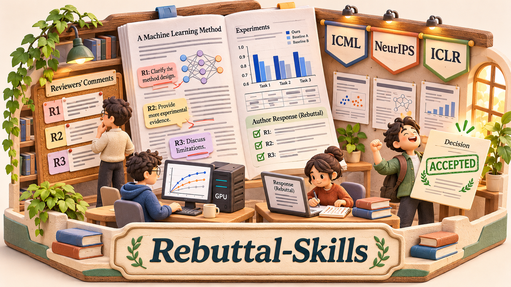

<p align="center">
</p>

<h1 align="center">Rebuttal-Skills</h1>

<p align="center"><strong>I built this skill for planning experiments, drafting author responses, and rehearsing with simulated reviewers, drawing on my own rebuttals and 330 ICLR submissions whose scores rose during discussion.</strong></p>

<p align="center"><strong>English</strong> · <a href="README.zh-CN.md">简体中文</a> · <a href="#installation">Installation</a> · <a href="#basic-usage">Basic usage</a> · <a href="examples/sorting/README.md">Worked example</a></p>

<p align="center"><a href="LICENSE"></a>
<a href="skills/rebuttal/SKILL.md"></a>
<a href="#claude-code"></a>
<a href="https://github.com/Jurio0304/Rebuttal-Skills/stargazers"></a>
<a href="https://github.com/Jurio0304/Rebuttal-Skills/forks"></a></p>

---

## What is Rebuttal-Skills?

Across my ICML, NeurIPS, and ICLR submissions, the total reviewer scores rose by four, four, and three points respectively. I wanted to share how I chose the experiments and wrote the replies that went into those discussions.

Rebuttal-Skills gives an AI assistant a set of instructions for working with you on a conference rebuttal. Give it your submitted paper, the reviews, and the response rules for your track. You can ask it to help you choose one experiment, draft an answer to one reviewer, or follow the discussion through to the manuscript revision.

One judgment I wanted it to help with is what to do when two reviewers request the same baseline. One may be asking whether the comparison was fair. The other may want to know whether your method is worth using on a short job. A single well-chosen comparison can answer both, but each reviewer needs to hear what the result means for *their* question.

## My ICML, NeurIPS, and ICLR rebuttals

| Submission | Initial ratings | After rebuttal | Total gain | Mean score change | Outcome |
| --- | --- | --- | ---: | ---: | --- |
| ICML | ${\color{#C73746}2} / {\color{#C73746}3} / {\color{#C73746}3} / {\color{#C73746}3}$ | ${\color{#C73746}3} / {\color{#C73746}3} / {\color{#168348}4} / {\color{#168348}5}$ | ${\color{#168348}+4}$ | 2.75 → 3.75 (${\color{#168348}+1.00}$) | Rejected, then revised and resubmitted to NeurIPS |
| NeurIPS | ${\color{#C73746}2} / {\color{#C73746}3} / {\color{#C73746}3}$ | ${\color{#168348}4} / {\color{#168348}4} / {\color{#168348}4}$ | ${\color{#168348}+4}$ | 2.67 → 4.00 (${\color{#168348}+1.33}$) | **Accepted as a poster** |
| ICLR | ${\color{#C73746}2} / {\color{#C73746}2} / {\color{#168348}3}$ | ${\color{#168348}3} / {\color{#168348}3} / {\color{#168348}4}$ | ${\color{#168348}+3}$ | 2.33 → 3.33 (${\color{#168348}+1.00}$) | Submission, Top 0.7~3.5% |

<sub>Ratings follow each venue’s scale. Red indicates a rating on the reject side and green a rating on the accept side. A 3 leans reject at ICML and NeurIPS and accept at ICLR. Means are rounded to two decimals.</sub>

The first two rows are the same paper. At ICML, one reviewer raised their score from 3 to 5, and another kept their 3 after reading my reply. The average went up by one point, but the paper was still borderline and was ultimately rejected 😮‍💨. We revised it and submitted it to NeurIPS, where the three reviewers’ scores rose by four points in total and the paper was accepted. I went through three full rounds of discussion with the hardest reviewer to convince, who had initially given the paper a 2. My first ICLR submission started at 2/2/3, and after rebuttal one of the reviewers who gave it a 2 raised it straight to 4 🤩. Although ICLR allows multiple replies under each review, I replied just once to each of the three reviewers, within 5,000 characters each. To me, a longer thread may look more substantial and show how much work went in, but a brief reply addressing the reviewer’s main concern may be more efficient and easier on the reviewer.

## The eight stages

Start at the row that matches the work on your desk. If you already have a draft, you can go straight to stage 5. If a reviewer has just replied, stage 6 takes your earlier answer and the new comment as its starting point.

| Stage | What you get |
| --- | --- |
| 1. [Read the reviews](skills/rebuttal/references/stages/01-intake.md) | Each reviewer’s questions in their original order, with the relevant passages in the paper and the issues that still need evidence. |
| 2. [Plan the work](skills/rebuttal/references/stages/02-plan.md) | A prioritized plan that fits the time and compute you have, including which comparison would settle which question. |
| 3. [Interpret the results](skills/rebuttal/references/stages/03-results.md) | An account of what the completed experiments establish, including mixed results and the conditions under which a claim holds. |
| 4. [Draft the replies](skills/rebuttal/references/stages/04-response.md) | A response for each reviewer, grounded in the submitted paper and completed work and sized to the venue’s limit. |
| 5. [Rehearse and revise](skills/rebuttal/references/stages/05-simulation.md) | One independent simulated reader per reviewer. Each reads their own review and reply, raises any remaining concern, and can read your clarification in the same thread. |
| 6. [Handle the discussion](skills/rebuttal/references/stages/06-discussion.md) | A reply to the question a real reviewer or area chair (AC) has just asked, taking into account what they already acknowledged. |
| 7. [Write the global response](skills/rebuttal/references/stages/07-global.md) | A short account for the AC of the main disagreements, the evidence, and what the reviewers actually said or changed. |
| 8. [Revise the paper](skills/rebuttal/references/stages/08-revision.md) | A map from each promised change to its place in the manuscript, with edits to your chosen version when requested. |

The fictional **RunFold** example follows a sorting paper through all eight stages. Start with the paper and its three reviews, pick the one comparison you would run, then open the measurements. You can also read the recorded rehearsal to see which sentence prompted a follow-up and how the same simulated reviewer responded to a clarification. [Paper and reviews](examples/sorting/01-intake.md) · [Measurements](examples/sorting/02-evidence.md) · [Three-reviewer rehearsal](examples/sorting/04-panel.md) · [Full walkthrough](examples/sorting/README.md)

## Installation

Clone the repository once to a shared location. If you already have a checkout containing `skills/rebuttal/SKILL.md`, use its absolute path in place of `$HOME/Rebuttal-Skills` below.

```sh
git clone https://github.com/Jurio0304/Rebuttal-Skills.git "$HOME/Rebuttal-Skills"
```

For each paper, open a shell in the paper’s workspace and follow the instructions for your client. The commands link the skill into that workspace and preserve any existing entry named `rebuttal`.

### Codex

```sh
mkdir -p .agents/skills
ln -s "$HOME/Rebuttal-Skills/skills/rebuttal" .agents/skills/
```

Start a Codex session in that workspace and invoke `$rebuttal`. I verified project-level skill discovery in Codex CLI and ran the three-reviewer rehearsal with independent agents. [Local verification](evals/README.md#local-verification)

### Claude Code

```sh
mkdir -p .claude/skills
ln -s "$HOME/Rebuttal-Skills/skills/rebuttal" .claude/skills/
```

Start Claude Code in that workspace and invoke `/rebuttal`. These are the project-level setup instructions for Claude Code. The recorded verification used Codex.

### Ask your assistant to install it

Give a local coding assistant the repository URL or checkout path, the path to your paper workspace, and the name of your client. You can paste this request into Codex from your paper workspace.

> Install Rebuttal-Skills from https://github.com/Jurio0304/Rebuttal-Skills for Codex in this paper workspace. Reuse my local checkout if available. Follow the README’s project-level instructions, preserve any existing installation, and show me how to invoke the skill.

### Without installation

Paste the skill entry point and the guide for your current stage into a chat, then supply the paper excerpts, review, or draft you want it to work on. For an independent rehearsal in a client without subagents, use one fresh chat per reviewer and give each chat only that reviewer’s packet. [Skill entry point](skills/rebuttal/SKILL.md) · [Stage guides](skills/rebuttal/references/stages) · [Reviewer brief](skills/rebuttal/assets/reviewer-brief.md)

## Basic usage

- **Understand a review.** “Read the submitted paper and these reviews. Keep each reviewer’s question numbers. For each question, show me what I can answer from the paper today and what I still need to find out.”
- **Choose one experiment.** “I have two days and time for one run. R1 questions the baseline’s tuning budget, and R2 asks whether our gain holds on short jobs. Design one comparison and explain what I could tell each reviewer if it wins or ties.”
- **Write up a mixed result.** “Here are the per-seed results. We gain on long jobs and tie on short ones. Draft the answer to R2 using the actual numbers, and suggest the smallest change to the claim in our abstract.”
- **Rehearse a draft.** “Give each of the three reviewers an independent read of their own reply. Show me any sentence that leaves their original question open. Once I clarify it, have the same simulated reviewer read it again.”
- **Reply to a follow-up.** “R2 accepted the fairness control and now asks how we averaged across seeds. Here are their comment, our earlier reply, and the aggregation rule. Draft a short follow-up that answers the new question.”
- **Summarize for the AC.** “Use the public discussion below to draft a global response. R1 wrote that they intend to raise their rating, and R2 has already changed theirs. Attribute each event accurately.”
- **Carry promises into the paper.** “Compare the final author replies with this manuscript. For each promised edit, point me to the revised sentence or give me a patch for the change that is still missing.”

## Sources

I studied **330 ICLR 2027 submissions** whose total reviewer score rose by at least three points during discussion. In the November 5–18 window, **275** of those submissions had visible author replies, totaling **2,295 author comments**. I used model-assisted reading to examine one passage from each of **266 submissions**, looking at how authors presented evidence, explained a choice, narrowed a claim, or corrected the paper. Because I selected submissions by score gain, the study describes what authors wrote in those discussions. Estimating how a writing choice affects scores would require a different sample. [Discussion study, selection criteria, and sources](skills/rebuttal/references/discussion-patterns.md)

The venue guides cover ICML 2026, NeurIPS 2026, ICLR 2027, and AAAI-27. Each points to that cycle’s official guidance, so you can check details such as who can see a reply or when you can upload a revision. Corrections to a venue guide and original worked examples are welcome. [Venue guides](skills/rebuttal/references/venues) · [Source register](SOURCES.md) · [Contributing](CONTRIBUTING.md)

## Changelog

- **2026-11-25** — Initial local version with the eight stage guides, four venue guides, the ICLR discussion study, and a worked three-reviewer example.

## License

[MIT License](LICENSE)

## Acknowledgements

My thanks to [@956961](https://github.com/956961).

I also thank the following open-source projects. [Awesome Rebuttal](https://github.com/xiongqi123123/awesome-rebuttal) · [ARIS](https://github.com/wanshuiyin/Auto-claude-code-research-in-sleep) · [CCFA-Skills](https://github.com/mikubaka88/CCFA-Skills) · [CCF-A-Skills](https://github.com/kay-kuo/CCF-A-Skills) · [Rebuttal-Skill](https://github.com/TobiasLee/Rebuttal-Skill) · [Review2Rebuttal](https://github.com/Henryhe09/Review2Rebuttal)

## Star History

<a href="https://www.star-history.com/#Jurio0304/Rebuttal-Skills&amp;Date">
  <picture>
    <source media="(prefers-color-scheme: dark)" srcset="https://api.star-history.com/svg?repos=Jurio0304/Rebuttal-Skills&amp;type=Date&amp;theme=dark" />
    <source media="(prefers-color-scheme: light)" srcset="https://api.star-history.com/svg?repos=Jurio0304/Rebuttal-Skills&amp;type=Date" />
    
  </picture>
</a>
